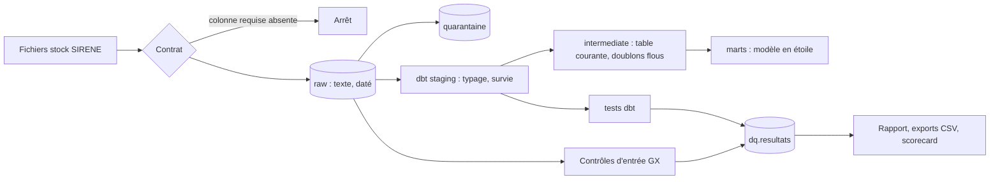

# Plateforme de données d'entreprises, qualité intégrée

Pipeline de bout en bout sur la base SIRENE de l'Insee (entreprises et établissements
français) : ingestion pilotée par des data contracts, chargements idempotents, transformations
et tests dbt et GX, modèle en étoile, quarantaine, score qualité historisé à chaque run, scorecard et
gouvernance. Orchestré chaque jour par Airflow, sur les données réelles.

> **Statut v1 : données réelles.** Depuis le 10/11/2026, le DAG Airflow charge chaque jour les
> fichiers stock SIRENE sur Paris et les Hauts-de-Seine (5,1 millions d'établissements et
> 3,8 millions d'unités légales). Un
> échantillon synthétique avec anomalies injectées reste disponible pour les tests, dans un
> entrepôt séparé.

## Résumé

- **Le problème :** SIRENE est publique, volumineuse (environ 3 Go par chargement) et imparfaite :
  doublons, codes invalides, sièges introuvables, données personnelles à masquer.
- **Ce que fait le projet :** il télécharge, charge, contrôle, isole les lignes en défaut, calcule
  un score par dimension de qualité et **bloque la publication** si une règle bloquante dépasse
  son seuil.
- **Résultat :** un scorecard régénéré à chaque run, 13 règles évaluées, un historique par jour,
  et un premier.
- **Bonus :** incident réel détecté et bloqué automatiquement (voir [Incident réel](#incident-réel--données-nominatives-en-diffusion-partielle)).


*Scorecard du 10/11/2026, généré par `python dashboards/scorecard.py` à partir
des exports du pipeline. Données réelles, Paris et Hauts-de-Seine.*

## Application des principes de qualité et gouvernance à l'ingénierie de données

| Côté data engineering | Côté qualité et gouvernance |
|---|---|
| Ingestion pilotée par contrat (ODCS), arrêt sur rupture de schéma | Catalogue de règles versionné, avec seuil et criticité |
| Chargement daté et idempotent : rejouer une date ne crée pas de doublons | Contrôles d'entrée (Great Expectations) et tests dbt dans une seule table de résultats |
| Couches raw, staging, intermediate, marts ; modèle en étoile ; table courante incrémentale | Quarantaine plutôt que correction silencieuse |
| DAG Airflow quotidien : téléchargement conditionnel, relances, alerte, purge | Score par dimension pondéré par la criticité, historisé à chaque run |
| DuckDB et dbt, parquet en entrée, mémoire maîtrisée | Glossaire métier, inventaire RGPD, conservation de 90 jours, masquage des personnes en diffusion partielle |

## Architecture



Le DAG `pipeline_plateforme_donnees_complete` enchaîne :

1. **Téléchargement** : les fichiers ne sont retéléchargés que si data.gouv.fr publie une version
   plus récente.
2. **Chargement** : le contrat de chaque source (`contracts/`) décide des colonnes lues et
   arrête tout si une colonne requise manque. La date des données vient du run Airflow, pas de
   l'horloge => rejouer une date remplace ses lignes.
3. **Contrôles d'entrée** : Great Expectations sur le brut. Une règle bloquante en échec arrête
   le DAG avant dbt.
4. **Transformation et tests** : dbt type les colonnes, applique la règle de survie, isole les
   SIRET absents ou mal formés en quarantaine, maintient la table courante des établissements
   en incrémental et construit le modèle en étoile (faits des créations, dimensions activité,
   localisation et unité légale).
5. **Publication et verdict** : résultats GX et dbt réunis dans `dq.resultats`, exports CSV,
   scorecard. Si une règle bloquante dépasse son seuil ou si dbt échoue, le run échoue, les marts
   ne sont pas publiés et une alerte part.
6. **Purge** : les chargements bruts de plus de 90 jours sont supprimés (politique de
   conservation documentée dans l'inventaire RGPD), seulement si le run a réussi.

## Ce que montre le scorecard 

| Indicateur | Valeur au 10/11/2026 |
|---|---|
| Volume chargé | 5 108 892 établissements, 3 767 118 unités légales |
| Score global | 98,85 % |
| Règles bloquantes en échec | 0 sur 3 : publication autorisée |
| Règles au-dessus de leur seuil | 6 sur 13 |
| Dimension la plus faible | Validité, 95,27 % |

**Ce qu'il faut en retenir :** la dimension Validité est tirée vers le bas par deux règles :
le format du code APE (R07, 1 117 738 établissements, 21,9 %) et le code postal à 5 chiffres
(R08, 663 871 établissements, 13,0 %). Des taux aussi élevés sur une source officielle
signalent d'abord une règle à revoir avant une donnée fausse : leur analyse est en cours
(voir [Limites et suite](#limites-et-suite)).

## Incident réel : données nominatives en diffusion partielle

Au premier run sur les données réelles, la règle bloquante R19 (« aucune donnée nominative
exposée pour une personne en diffusion partielle ») a échoué : **4 480 unités légales sur
427 721 (1,05 %)** affichaient un nom dans le mart, pour un seuil de 0 %.

- **Détection et blocage :** le DAG a refusé de publier les marts et a déclenché l'alerte.
- **Analyse :** 100 % des lignes en échec portaient la valeur `[ND]`, le marqueur par lequel
  l'Insee masque une donnée non diffusible. Il n'y avait donc pas de fuite : le nom était déjà
  masqué à la source. Mais ce marqueur n'était pas converti en NULL pour la dénomination, alors
  qu'il l'était pour le nom et le prénom.
- **Correction :** la dénomination est nettoyée en staging comme les autres champs d'identité.
  R19 repasse sous son seuil.
- **Leçon à en tirer:** l'échantillon de test ne contenait ce marqueur que dans les colonnes attendues.
  Seules les données réelles ont révélé le cas, et c'est la règle bloquante qui l'a attrapé
  avant publication.
- **Effet de bord :** au run suivant, la règle R13 (« dénomination renseignée pour les
  personnes morales ») compte exactement 4 480 dénominations manquantes. Ce sont les mêmes
  unités : leur dénomination, désormais NULL, est masquée à la source, pas absente. Une donnée
  masquée n'est pas une donnée manquante => R13 doit donc exclure les unités en diffusion partielle à l'avenir.

## Ce que les données m'ont appris

Sur les fichiers stock réels (Paris et Hauts-de-Seine) :

1. **12 % des sièges sont introuvables (environ 458 000).** Charger un périmètre de
   départements coupe le lien entre une entreprise et son siège situé ailleurs. Un filtre
   de périmètre casse l'intégrité référentielle : la règle « un seul siège par unité légale »
   ne contrôle donc que les unités dont le siège est dans le périmètre.
2. **Le code APE 70.10Z(activité officielle des sièges sociaux) est environ 8 fois plus fréquent chez les sièges (28 000 contre 3 500).**
   C'est l'effet de la domiciliation : le siège n'est pas le lieu de l'activité. Décision
   documentée dans le [glossaire](docs/glossaire.md) => on localise donc une entreprise par la commune
   de son siège, mais on compte les établissements pour analyser un territoire.
3. **Un index divise par 3 le temps d'une recherche ponctuelle (0,034 s à 0,010 s), et ne
   change rien aux agrégations.** DuckDB est un moteur en colonnes : une requête qui lit toute
   la table ne profite pas de l'index. On indexe pour les recherches par SIRET, pas pour les
   tableaux de bord.

## Choix techniques

| Choix | Pourquoi |
|---|---|
| DuckDB plutôt que PostgreSQL | Lit le parquet directement, rapide en analytique, pas besoin de serveur. Pas d'écritures concurrentes : un seul run Airflow à la fois (`max_active_runs=1`) |
| dbt pour les transformations et les tests | SQL versionné, tests déclaratifs, lignage |
| Great Expectations à l'entrée, dbt après | Bloquer tôt sur le brut, contrôler la logique métier après typage |
| Quarantaine plutôt que correction | Mesurer les défauts et pouvoir les signaler au producteur |
| Score pondéré par criticité | Une règle bloquante pèse 3 fois plus qu'une règle mineure |
| Entrepôts séparés pour l'échantillon et le réel | L'historique qualité et la future règle de volume ne mélangent jamais données de test et données réelles |

## Lancer le projet

```bash
python -m venv .venv
source .venv/bin/activate            # Windows : .venv\Scripts\activate
pip install -r requirements.txt

python pipeline.py echantillon       # échantillon synthétique avec anomalies connues
python pipeline.py run               # pipeline complet et rapport qualité
python dashboards/scorecard.py       # scorecard : dashboards/scorecard.png
```

Données réelles :

```bash
python pipeline.py telecharger       # fichiers stock parquet (environ 2,8 Go)
python pipeline.py run --source reel # périmètre : départements de config.yml
python dashboards/scorecard.py --mention ""
```

Orchestration : le DAG `dags/pipeline_complete_dag.py` lance le pipeline chaque jour.
Docker : `docker compose build` puis `docker compose run --rm pipeline run`.

## Limites et suite

- **Ne recharger que les nouveaux fichiers.** Le téléchargement est déjà conditionnel, mais
  l'ingestion recharge chaque jour le même fichier mensuel : la sauter quand rien n'a changé.
- **Masquage fondé sur le statut de diffusion** dans les marts, quelle que soit la façon dont
  la source marque les données ; R13 adaptée pour ne plus compter les dénominations masquées.
- **Analyser R07 et R08** (code APE et code postal) : distinguer les vraies erreurs des cas
  légitimes (anciennes nomenclatures, établissements sans adresse en France…) avant de
  corriger la règle ou de remonter les anomalies.
- **Règle de volume R17** et procédure de rejeu documentée.
- **Passage à l'échelle** : tout le territoire en PySpark.
- **Catalogue et lignage** : OpenMetadata, à partir du glossaire et du catalogue des règles.

## Données et RGPD

Les données SIRENE sont publiées par l'Insee sous Licence Ouverte 2.0. Elles contiennent des
données personnelles (entrepreneurs individuels) : le dossier `data/` n'est jamais versionné,
les personnes en diffusion partielle sont masquées dans les marts (règle bloquante R19), les
chargements bruts sont conservés 90 jours, et l'inventaire des traitements est dans
[`docs/rgpd-inventaire.md`](docs/rgpd-inventaire.md).
