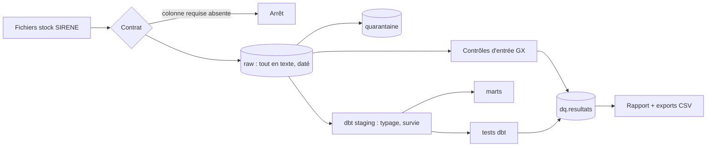

# Plateforme de données d'entreprises, qualité intégrée

Pipeline de bout en bout sur les données publiques d'entreprises françaises (base SIRENE
de l'Insee) : ingestion pilotée par des data contracts, chargements idempotents,
transformations et tests dbt, quarantaine, score de qualité historisé, gouvernance et
respect du statut de diffusion.

> **Kit de démarrage.** Ce README explique comment faire tourner le projet. Quand ta v1
> sera prête, remplace-le par le README final (modèle dans le hub, onglet « Présenter »).

## Deux façons de lire ce projet

| Côté data engineering | Côté qualité et gouvernance |
|---|---|
| Ingestion pilotée par contrat, arrêt sur rupture de schéma | Catalogue de règles versionné, seuils et criticités |
| Chargement daté et idempotent, évolution de schéma | Contrôles d'entrée (Great Expectations) et tests dbt |
| Couches raw, staging, marts ; règle de survie | Quarantaine plutôt que correction silencieuse |
| Tests automatisés, CI, Docker | Score par dimension, historisé à chaque run |
| À venir : modèle en étoile, incrémental, Airflow, PySpark, Azure | À venir : catalogue et lignage, incident, MDM |

## Feuille de route du dépôt

| Version | Data engineering | Qualité et gouvernance |
|---|---|---|
| v1 (avant les candidatures) | Données réelles, modèle en étoile (E1), chargement incrémental (E2), premier DAG Airflow | 20 règles, scorecard, glossaire, inventaire RGPD |
| v2 (pendant les candidatures) | Airflow complet, tout le territoire en PySpark sur Databricks (E3, E4), CI enrichie | Catalogue et lignage (OpenMetadata), incident simulé, règle inter-sources (API) |
| v3 | Déploiement Azure avec Terraform, flux Kafka, FinOps | Bascule NAF 2025 (nouvelle version de contrat), golden record |

## Démarrer (environ 5 minutes)

```bash
python -m venv .venv
source .venv/bin/activate            # Windows : .venv\Scripts\activate
pip install -r requirements.txt

python pipeline.py echantillon       # données synthétiques au format SIRENE
python pipeline.py run               # pipeline complet + rapport qualité
```

Python 3.11 ou 3.12 recommandé. Sous Windows, utilise `python pipeline.py …` directement ;
le Makefile n'est qu'un raccourci pour macOS et Linux.

## Passer aux vraies données

```bash
python pipeline.py telecharger       # fichiers stock parquet (~2,8 Go) + référentiel des communes
python pipeline.py run --source reel # périmètre : les départements de config.yml
```

Les fichiers stock sont publiés une fois par mois : un téléchargement par mois suffit.

## Ce que fait `run`



1. **Chargement** (`plateforme/chargement.py`) : le contrat de chaque source
   (`contracts/`) décide des colonnes lues et de leur nom, et arrête tout si une colonne
   requise manque. Recharger une date remplace ses lignes : le rejeu ne crée pas de doublons.
2. **Contrôles d'entrée** (`plateforme/controles_gx.py`) : Great Expectations sur le brut.
3. **Transformation et tests** (`dbt/`) : quarantaine des SIRET absents ou mal formés,
   règle de survie pour les doublons, typage, marts, tests de qualité.
4. **Collecte** (`plateforme/collecte.py`) : les résultats des tests dbt rejoignent
   ceux de GX dans une seule table, `dq.resultats`, historisée à chaque run.
5. **Rapport** : score par dimension pondéré par la criticité, règles en échec, exports CSV
   pour le scorecard (`exports/`). Le code de sortie vaut 1 si une règle bloquante dépasse
   son seuil : dans un orchestrateur, c'est ce qui empêche la publication.

## Les règles

Le catalogue est dans `qualite/regles.yml` (source unique) et se lit dans
[`docs/catalogue-regles.md`](docs/catalogue-regles.md) (généré par `python pipeline.py catalogue`).
13 règles sont implémentées ; les autres sont les exercices des phases 1 et 2 du hub.

## Pièges déjà rencontrés (et racontables en entretien)

- **Arrondissements** : SIRENE code les établissements de Paris, Lyon et Marseille avec le
  code de l'arrondissement (75101…), pas celui de la commune (75056). Sans les arrondissements
  dans le référentiel, la règle R06 déclarerait fausses des données justes.
- **La Poste** : ses SIRET ne respectent pas la clé de Luhn et suivent une règle propre.
  Exception documentée dans le test `luhn_valide`, pas « corrigée ».
- **Diffusion partielle** : les personnes qui se sont opposées à la diffusion apparaissent
  avec des marqueurs `[ND]`. Ils deviennent des NULL en staging, et la règle bloquante R19
  garantit qu'aucun nom ne remonte dans les marts.
- **Périmètre** : en ne chargeant qu'un département, des établissements ont leur siège
  ailleurs. R12 ne contrôle donc que les unités dont le siège est dans le périmètre.
- **Compter juste** : `accepted_values` de dbt renvoie une ligne par valeur distincte, pas
  par enregistrement. Le test `dans_liste` compte les enregistrements.
- **NAF 2025** : l'Insee diffuse à titre informatif un code NAF 2025 depuis décembre 2025,
  et bascule en janvier 2027. La colonne est optionnelle dans le contrat (version 1.1.0).

## Commandes

| Commande | Effet |
|---|---|
| `python pipeline.py echantillon` | Génère un échantillon synthétique avec des anomalies connues |
| `python pipeline.py run [--source reel] [--date AAAA-MM-JJ]` | Pipeline complet |
| `python pipeline.py historique --jours 7` | Simule 7 jours de chargements (tendance, dérive de volume au jour 5) |
| `python pipeline.py rapport` | Réaffiche le rapport du dernier run |
| `python pipeline.py catalogue` | Régénère le catalogue des règles |
| `python pipeline.py docs` | Documentation dbt et lignage (`dbt/target/index.html`) |
| `python pipeline.py telecharger [--force]` | Télécharge les sources réelles |
| `python pipeline.py api --n 50` | Interroge l'API Recherche d'entreprises (phase 2, règle R16) |
| `python -m pytest -q` | Tests unitaires et pipeline complet sur échantillon (lancés aussi par la CI) |

Pour explorer l'entrepôt : `duckdb data/entrepot.duckdb`, puis par exemple
`SELECT * FROM main_controles.luhn_valide_stg_etablissements_siret;` pour voir les lignes en échec.

## Docker

```bash
docker compose build
docker compose run --rm pipeline echantillon
docker compose run --rm pipeline run
```

## Données et RGPD

Les données SIRENE sont publiées par l'Insee sous Licence Ouverte 2.0. Elles contiennent des
données personnelles (entrepreneurs individuels) : le dossier `data/` n'est jamais versionné,
et l'inventaire des traitements est dans [`docs/rgpd-inventaire.md`](docs/rgpd-inventaire.md).
