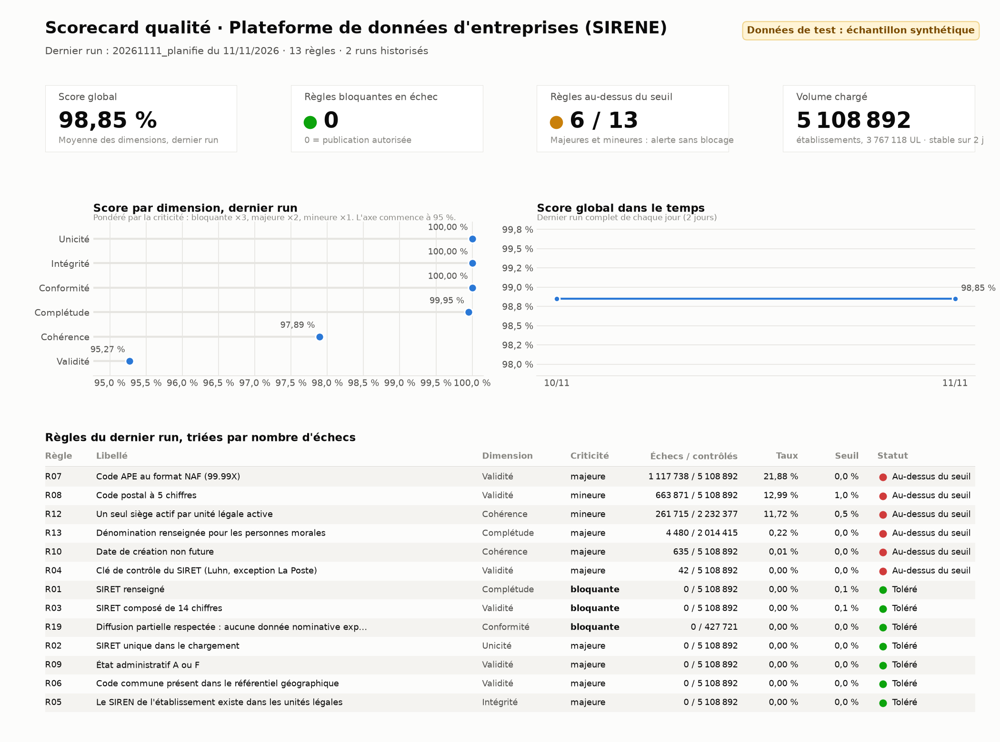
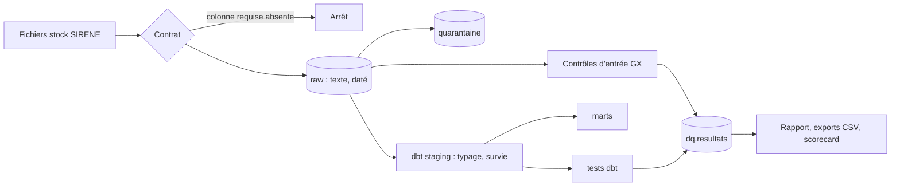

# Plateforme de données d'entreprises, qualité intégrée


Pipeline de bout en bout sur la base SIRENE de l'Insee (entreprises et établissements
français) : ingestion pilotée par des data contracts, chargements idempotents, transformations
et tests dbt, quarantaine, score qualité historisé à chaque run, scorecard et gouvernance.
Orchestré chaque jour par Airflow.

> **Statut v1 : données de test.** Le scorecard ci-dessous est calculé sur l'**échantillon de
> test** du projet (données synthétiques au format SIRENE, environ 5 800 établissements, avec des
> anomalies injectées volontairement). Le DAG Airflow tourne aujourd'hui sur cet échantillon.
> Le passage du DAG aux fichiers stock réels est la prochaine étape (voir [Limites et suite](#limites-et-suite)).
> Les trois constats chiffrés viennent, eux, d'un run exploratoire sur les données réelles.

## Résumé

- **Le problème :** SIRENE est publique, volumineuse (environ 3 Go par chargement) et imparfaite :
  doublons, codes invalides, sièges introuvables, données personnelles à masquer.
- **Ce que fait le projet :** il charge, contrôle, isole les lignes en défaut, calcule un score
  par dimension de qualité et **bloque la publication** si une règle bloquante dépasse son seuil.
- **Resultat :** un scorecard régénéré à chaque run, 13 règles évaluées, un historique par jour.



*Scorecard du 09/11/2026, généré par `python dashboards/scorecard.py` à partir des exports du
pipeline. Données de test.*

## Application des principes de qualité et gouvernance à l'ingénierie de données

| Côté data engineering | Côté qualité et gouvernance |
|---|---|
| Ingestion pilotée par contrat (ODCS), arrêt sur rupture de schéma | Catalogue de 13 règles versionné, avec seuil et criticité |
| Chargement daté et idempotent : rejouer une date ne crée pas de doublons | Contrôles d'entrée (Great Expectations) et tests dbt dans une seule table de résultats |
| Couches raw, staging, marts ; règle de survie pour les doublons | Quarantaine plutôt que correction silencieuse |
| DAG Airflow quotidien, Docker, tests et CI | Score par dimension pondéré par la criticité, historisé à chaque run |
| DuckDB et dbt, parquet en entrée | Glossaire métier, inventaire RGPD, masquage des personnes en diffusion partielle |


## Architecture



1. **Chargement** : le contrat de chaque source (`contracts/`) décide des colonnes lues et
   arrête tout si une colonne requise manque. Recharger une date remplace ses lignes.
2. **Contrôles d'entrée** : Great Expectations sur le brut.
3. **Transformation et tests** : dbt type les colonnes, applique la règle de survie, isole les
   SIRET absents ou mal formés en quarantaine et construit les marts.
4. **Collecte** : résultats GX et dbt réunis dans `dq.resultats`, une ligne par règle et par run.
5. **Rapport** : score par dimension, exports CSV (`exports/`) et scorecard. Le code de sortie
   vaut 1 si une règle bloquante dépasse son seuil : dans Airflow, c'est ce qui arrête la publication.

## Ce que montre le scorecard (données de test)

| Indicateur | Valeur au 09/11/2026 |
|---|---|
| Score global | 99,50 % |
| Règles bloquantes en échec | 0 sur 3 : publication autorisée |
| Règles au-dessus de leur seuil | 9 sur 13 |
| Dimension la plus faible | Unicité, 98,00 % (116 SIRET en double sur 5 807) |
| Historique | 11 runs sur 6 jours, score stable |

**Ce qu'il faut en retenir :** un score de 99,5 % cohabite avec 9 règles sur 13 en alerte.
Un score agrégé seul rassure à tort ; c'est pourquoi le scorecard affiche toujours le détail
par règle à côté. Sur l'échantillon, chaque anomalie injectée est bien détectée par la règle
prévue, et les trois règles bloquantes (SIRET renseigné, SIRET à 14 chiffres, aucune donnée
nominative exposée) restent sous leur seuil.

## Ce que les données m'ont appris

Run exploratoire sur les fichiers stock réels (Paris et Hauts-de-Seine, octobre 2026 :
3 746 269 établissements, environ 17 minutes, score global 98,68 %).

1. **12 % des sièges sont introuvables (environ 458 000).** Charger un périmètre de
   départements coupe le lien entre une entreprise et son siège situé ailleurs. Un filtre
   de périmètre casse l'intégrité référentielle : la règle « un seul siège par unité légale »
   ne contrôle donc que les unités dont le siège est dans le périmètre.
2. **Le code APE 70.10Z est environ 8 fois plus fréquent chez les sièges (28 000 contre 3 500).**
   C'est l'effet de la domiciliation : le siège n'est pas le lieu de l'activité. Décision
   documentée dans le [glossaire](docs/glossaire.md) : on localise une entreprise par la commune
   de son siège, mais on compte les établissements pour analyser un territoire.
3. **Un index divise par 3 le temps d'une recherche ponctuelle (0,034 s à 0,010 s), et ne
   change rien aux agrégations.** DuckDB est un moteur en colonnes : une requête qui lit toute
   la table ne profite pas de l'index. On indexe pour les recherches par SIRET, pas pour les
   tableaux de bord.

## Choix techniques

| Choix | Pourquoi |
|---|---|
| DuckDB plutôt que PostgreSQL | Lit le parquet directement, rapide en analytique, pas besoin de serveur. Pas d'écritures concurrentes ; un seul processus écrit à la fois |
| dbt pour les transformations et les tests | SQL versionné, tests déclaratifs, lignage possible |
| Great Expectations à l'entrée, dbt après | Bloquer tôt sur le brut, contrôler la logique métier après typage |
| Quarantaine plutôt que correction | Afin de pouvoir mesurer les défauts et les signaler |
| Score pondéré par criticité | Une règle bloquante pèse 3 fois plus qu'une règle mineure |

## Incident simulé

À venir. La commande `python pipeline.py historique --jours 7 --incident 5` simule un fichier
tronqué au jour 5 (40 % de lignes en moins). La règle de volume R17 (« volume dans ±3
écarts-types des 7 chargements précédents ») doit le détecter et bloquer la publication ;
elle est en cours d'implémentation. Le compte rendu ira dans [`docs/incidents/`](docs/incidents/).

## Lancer le projet

```bash
python -m venv .venv
source .venv/bin/activate            # Windows : .venv\Scripts\activate
pip install -r requirements.txt

python pipeline.py echantillon       # échantillon synthétique avec anomalies connues
python pipeline.py run               # pipeline complet et rapport qualité
python dashboards/scorecard.py       # scorecard : dashboards/scorecard.png
```

Données réelles :

```bash
python pipeline.py telecharger       # fichiers stock parquet (environ 2,8 Go)
python pipeline.py run --source reel # périmètre : départements de config.yml
python dashboards/scorecard.py --mention ""   # retire le bandeau « données de test »
```

Orchestration : un DAG Airflow lance le pipeline chaque jour (voir [`airflow/`](airflow/)).
Docker : `docker compose build` puis `docker compose run --rm pipeline run`.

## Limites et suite

- **Passer le DAG sur les données réelles** (`--source reel`). Les fichiers stock SIRENE
  sont publiés une fois par mois : le DAG doit détecter un nouveau fichier plutôt que
  recharger chaque jour le même.
- **Règle de volume R17** et premier incident documenté.
- **Modèle en étoile et chargement incrémental** (dbt).
- **Passage à l'échelle** : tout le territoire en PySpark.
- **Catalogue et lignage** : OpenMetadata, à partir du glossaire et du catalogue des règles.

## Données et RGPD

Les données SIRENE sont publiées par l'Insee sous Licence Ouverte 2.0. Elles contiennent des
données personnelles (entrepreneurs individuels) : le dossier `data/` n'est jamais versionné,
les personnes en diffusion partielle sont masquées dans les marts (règle bloquante R19) et
l'inventaire des traitements est dans [`docs/rgpd-inventaire.md`](docs/rgpd-inventaire.md).

